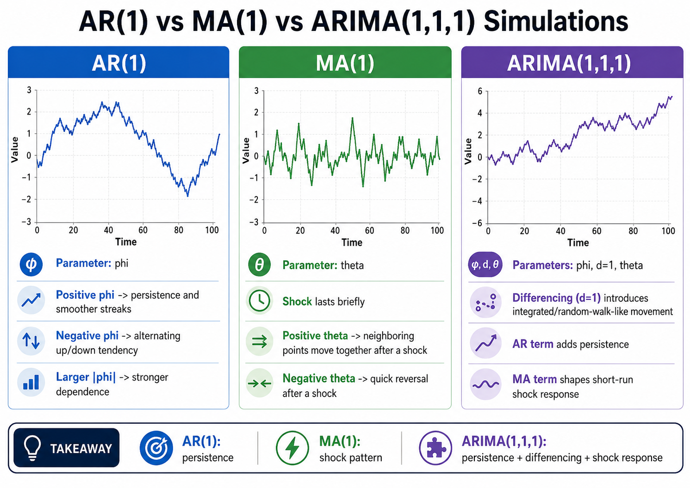
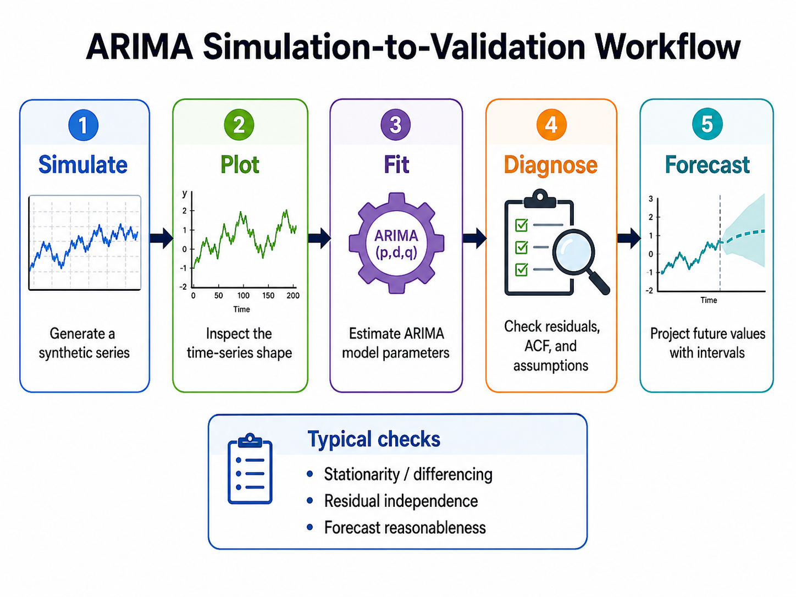
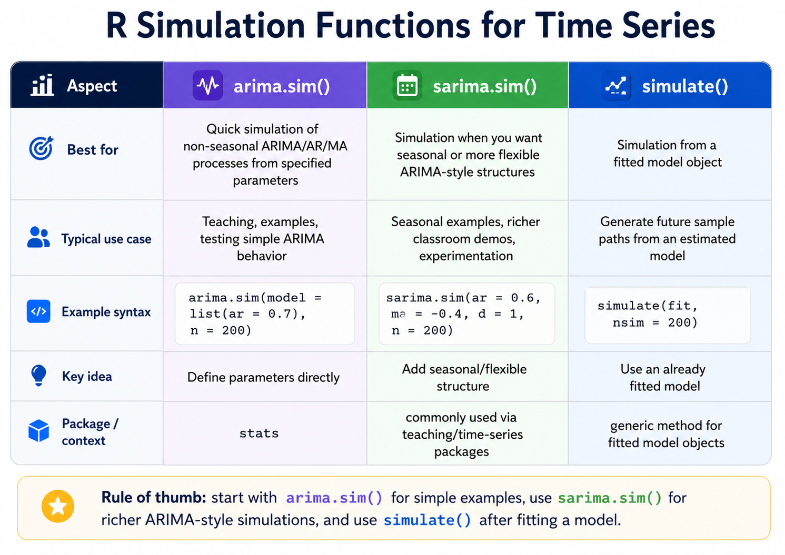

# Introduction

If you've ever needed to test a forecasting algorithm, validate a model, or simply teach time series concepts, **ARIMA simulation in R** is your secret weapon. Rather than waiting for real-world data, you can generate synthetic time series with known properties giving you full control over your experiments.

In this guide, I'm hoping you'll learn everything from basic `arima.sim()` syntax to seasonal ARIMA simulation, custom error distributions, and model validation workflows. Let's get started!

## What Is an ARIMA Model?

**ARIMA** stands for **AutoRegressive Integrated Moving Average**. A non-seasonal ARIMA model can be written as:

$$
(1-\phi_1B - \cdots - \phi_p B^p)(1-B)^d y_t = c + (1 + \theta_1 B + \cdots + \theta_q B^q)\varepsilon_t
$$


Where:
- **p** = autoregressive order
- **d** = degree of differencing
- **q** = moving average order
- **B** = backshift operator
- **ε_t** = white noise innovations

## Why Simulate ARIMA Data in R?

Simulating ARIMA data is valuable for:

- **Model validation** — fit a model to simulated data and check if recovered parameters match true values
- **Forecasting benchmarks** — test forecasting methods under controlled conditions
- **Teaching** — demonstrate time series concepts with reproducible examples
- **Monte Carlo analysis** — assess forecast uncertainty across many simulations

## Prerequisites: Packages and Setup

```{r load_libraries}
# Load libraries
library(forecast)
library(astsa)
library(ggplot2)

# Always set a seed for reproducibility!
set.seed(123)
```

## Understanding the arima.sim() Function

The `arima.sim()` function from R's built-in `stats` package is the primary tool for ARIMA simulation. Its syntax is:

```r
arima.sim(model, n, rand.gen = rnorm, innov = rand.gen(n, ...), 
          n.start = NA, start.innov = rand.gen(n.start, ...), ...)
```

The `model` argument takes **a list with component `ar` and/or `ma` giving the AR and MA coefficients respectively** .

| Argument | Description |
|----------|-------------|
| `model` | List specifying AR/MA coefficients and order |
| `n` | Number of observations to generate |
| `rand.gen` | Innovation generator function (default: `rnorm`) |
| `n.start` | Burn-in period length |
| `sd` | Standard deviation of innovations |

# Simulating AR, MA, and ARIMA Models

## AR(1) Model

```{r}
set.seed(123)
sim_ar1 <- arima.sim(model = list(ar = 0.7), n = 200)
ts.plot(sim_ar1, main = "Simulated AR(1) Process")
```

## MA(1) Model

```{r}
set.seed(123)
sim_ma1 <- arima.sim(model = list(ma = 0.5), n = 200)
ts.plot(sim_ma1, main = "Simulated MA(1) Process")
```

## Full ARIMA(2,1,1) Model

```{r}
set.seed(123)
sim_arima <- arima.sim(
  model = list(order = c(2,1,1), ar = c(0.5, 0.3), ma = 0.3), 
  n = 200
)
ts.plot(sim_arima, main = "Simulated ARIMA(2,1,1) Process")
```

## ARIMA(1,1,0) — Random Walk with Drift

A classic ARIMA simulation example from R's official documentation :

```{r}
ts.sim <- arima.sim(list(order = c(1,1,0), ar = 0.7), n = 200)
ts.plot(ts.sim)
```

## Custom Error Distributions

Beyond standard normal errors, `arima.sim()` supports custom distributions via `rand.gen`. For **mildly long-tailed distributions** using a t-distribution :

```{r}
# Standard normal innovations
arima.sim(n = 63, 
          list(ar = c(0.8897, -0.4858), ma = c(-0.2279, 0.2488)),
          sd = sqrt(0.1796))

# Long-tailed t-distribution innovations
arima.sim(n = 63, 
          list(ar = c(0.8897, -0.4858), ma = c(-0.2279, 0.2488)),
          rand.gen = function(n, ...) sqrt(0.1796) * rt(n, df = 5))
```

 This can be useful when modeling financial or economic data that exhibits heavier tails.

## Seasonal ARIMA Simulation with sarima.sim()

For seasonal models, the `astsa` package provides `sarima.sim()`. You can simulate a **SARIMA(0,1,1)×(0,1,1)₁₂** model, the classic airline model, like this:

```{r}
# Seasonal AR(1) with period 12
sim_seasonal <- sarima.sim(sar = 0.9, S = 12, n = 120)
ts.plot(sim_seasonal, main = "Simulated Seasonal AR(1)")

# Full airline model SARIMA(0,1,1)x(0,1,1)_12
sim_airline <- sarima.sim(ma = -0.4, sma = -0.6, S = 12, 
                           d = 1, D = 1, n = 144)
ts.plot(sim_airline, main = "Simulated Airline Model")
```

## Fitting a Model to Simulated Data

A key workflow is simulating data, then fitting a model to verify parameter recovery:

```{r}
set.seed(42)
# Simulate ARMA(1,1)
z <- arima.sim(n = 200, model = list(ar = 0.8, ma = -0.3))

# Fit ARMA(1,1) model
arma11 <- arima(z, order = c(1, 0, 1), include.mean = FALSE)

# Check residuals for serial correlation
checkresiduals(arma11)
```

 If the model fits well, residuals should resemble white noise with no significant autocorrelation.

## Using simulate() from the forecast Package

The `forecast` package offers an alternative `simulate()` method for `Arima` objects :

```{r}
# Fit model to real data
fit <- Arima(USAccDeaths, order = c(0,1,1), 
             seasonal = list(order = c(0,1,1), period = 12))

# Simulate future paths
sim_future <- simulate(fit, nsim = 36)

# Simulate model fit (future = FALSE for in-sample)
plot(simulate(fit, future = FALSE), col = 'red')
lines(USAccDeaths)
```

Setting `future = FALSE` is useful for **examining how well the model fits your existing data** .

# Visualizing Simulated Time Series

## Base R

```{r}
ts.plot(sim_ar1, main = "AR(1) Simulation", 
        ylab = "Value", col = "steelblue", lwd = 1.5)
```

## ggplot2

```{r}
library(ggplot2)
df <- data.frame(time = as.numeric(time(sim_ar1)), 
                 value = as.numeric(sim_ar1))

ggplot(df, aes(x = time, y = value)) +
  geom_line(color = "steelblue", linewidth = 0.8) +
  labs(title = "Simulated AR(1) Time Series",
       x = "Time", y = "Value") +
  theme_minimal()
```

# Common Mistakes and How to Avoid Them

| ❌ Mistake | ✅ Fix |
|-----------|--------|
| Forgetting `set.seed()` | Always set seed before simulation |
| Invalid AR/MA coefficients | Ensure stationarity/invertibility conditions are met |
| Ignoring burn-in period | Use `n.start` for stable initial conditions |
| Plotting raw vectors | Convert to `ts` object before plotting |
| Misspecifying `order` | Double-check `c(p, d, q)` matches your coefficients |

# 🎯 Your Turn! Practical Exercise

**Challenge:** Simulate 150 observations from an **ARIMA(1,0,1)** process with AR coefficient `0.6` and MA coefficient `0.4`. Plot the result using `ggplot2` and fit an ARIMA model to recover the parameters.

<details>
<summary>💡 See Solution</summary>

```{r}
set.seed(99)

# Step 1: Simulate ARIMA(1,0,1)
sim_101 <- arima.sim(
  model = list(order = c(1,0,1), ar = 0.6, ma = 0.4), 
  n = 150
)

# Step 2: Visualize with ggplot2
library(ggplot2)
df <- data.frame(
  time = as.numeric(time(sim_101)),
  value = as.numeric(sim_101)
)

ggplot(df, aes(x = time, y = value)) +
  geom_line(color = "steelblue", linewidth = 0.8) +
  labs(title = "Simulated ARIMA(1,0,1) Time Series",
       x = "Time", y = "Value") +
  theme_minimal()

# Step 3: Fit model and check parameter recovery
fit <- arima(sim_101, order = c(1,0,1))
print(fit)
# ar1 should be close to 0.6, ma1 close to 0.4
```

</details>

# ⚡ Quick Takeaways

- **`arima.sim()`** from the `stats` package is the primary tool for ARIMA simulation in R
- Always use **`set.seed()`** for reproducible results
- Specify the `model` argument as a list with `ar`, `ma`, and `order` components
- Use **`sarima.sim()`** from the `astsa` package for seasonal ARIMA simulation
- Custom error distributions are supported via the **`rand.gen`** argument
- The **`simulate()`** function from `forecast` works on fitted `Arima` objects 
- Fitting models to simulated data is a powerful **validation technique** 

# Conclusion

**ARIMA simulation in R** is a great skill for anyone interested in timeseries. R provides a rich toolkit: `arima.sim()`, `sarima.sim()`, and `simulate()`, to generate synthetic time series with the precision and flexibility you may need.

If you master these tools, you can validate models rigorously, benchmark forecasting algorithms, and build deeper intuition about time series and its associated dynamics. Start with the simple examples in this guide, then progressively explore more complex specifications.

# ❓ FAQs

**1. What is the minimum R version required for arima.sim()?**
`arima.sim()` is part of R's built-in `stats` package and has been available since R 1.0.0, so any modern R installation will include it.

**2. Can arima.sim() simulate seasonal ARIMA models?**
No — `arima.sim()` does not support seasonal components. Use `sarima.sim()` from the `astsa` package for seasonal ARIMA simulation.

**3. How do I ensure my AR coefficients are valid?**
For stationarity, the roots of the AR characteristic polynomial must lie outside the unit circle. For AR(1), this simply means `|ar| < 1`.

**4. What's the difference between arima.sim() and simulate() from forecast?**
`arima.sim()` generates data from scratch using specified parameters, while `simulate()` generates new observations from an already-fitted `Arima` model object .

**5. How many observations should I simulate for reliable parameter recovery?**
Generally, **n ≥ 200** observations provides stable parameter estimates. Shorter series may yield noisy coefficient estimates when fitting models.

# 💬 Engage!

**Found this guide helpful?** Drop a comment below! If this saved you time, please share it with your R community on LinkedIn, Twitter/X, or your favorite R forum. Your feedback helps us create better content for R programmers and forecasters like you!

# Some Visual Guides







------------------------------------------------------------------------

Happy Coding! 🚀

------------------------------------------------------------------------

*You can connect with me at any one of the below*:

*Telegram Channel here*: <https://t.me/steveondata>

*LinkedIn Network here*: <https://www.linkedin.com/in/spsanderson/>

*GitHub Network here*: <https://github.com/spsanderson>

*My Book: Extending Excel with Python and R* here: <https://packt.link/oTyZJ>

*You.com Referral Link*: <https://you.com/join/EHSLDTL6>

------------------------------------------------------------------------

@online{arima_simulation_in_r_the_complete_guide_for_r_programmers_and_forecasters_20260805, author = {Sanderson II MPH, Steven P.}, title = {ARIMA Simulation in R: The Complete Guide for R Programmers and Forecasters}, date = {2026-08-05}, url = {https://www.spsanderson.com/steveondata/posts/2026-08-05/}, langid = {en} }

```{=html}
<script src="https://giscus.app/client.js"
        data-repo="spsanderson/steveondata"
        data-repo-id="R_kgDOIIxnLw"
        data-category="Comments"
        data-category-id="DIC_kwDOIIxnL84ChTk8"
        data-mapping="url"
        data-strict="0"
        data-reactions-enabled="1"
        data-emit-metadata="0"
        data-input-position="top"
        data-theme="dark"
        data-lang="en"
        data-loading="lazy"
        crossorigin="anonymous"
        async>
</script>
```